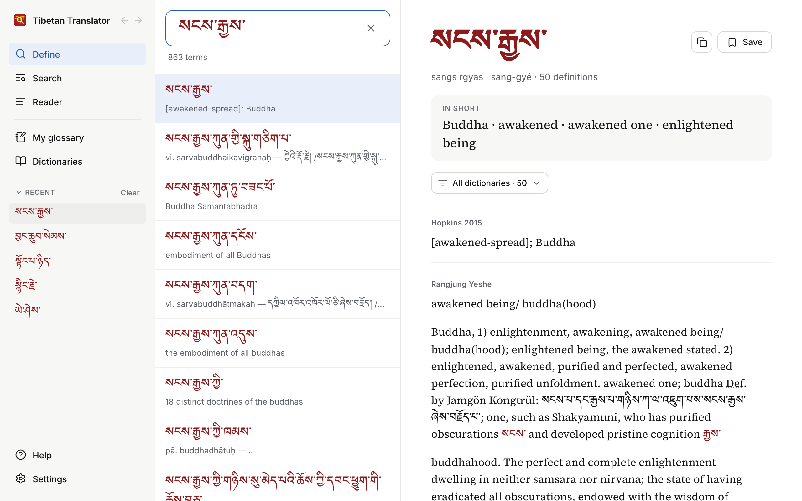

<p align="center">
  
</p>

<h1 align="center">Tibetan Translator</h1>

<p align="center"><i>The best Tibetan dictionaries, in a pleasant interface for all devices.</i></p>

<p align="center">
  Look up a Tibetan term, in Unicode or Wylie, across more than 60 dictionaries at once.<br>
  Works offline.
</p>

<p align="center">
  <a href="https://github.com/jerefrer/tibetan-translator/releases/latest"><b>Download</b></a>
  ·
  <a href="https://jerefrer.github.io/tibetan-translator/">Website</a>
  ·
  <a href="CHANGELOG.md">Release notes</a>
  ·
  macOS · Windows · Linux · iOS · Android
</p>

<p align="center">
  
</p>

## Features

- **60+ dictionaries** in one place, shown together on a single entry under a short summary.
- **Define**: type a Tibetan term in Unicode or Wylie and read every dictionary's definition of it.
- **Search** inside the definitions themselves, in English or Tibetan, with phonetic search, strict (`[chomdende]`) or loose (`{jomtenté}`), and a query builder to combine conditions.
- **Reader**: paste a Tibetan text and read it word by word, with the definitions beside it.
- **Recent and Saved**: the terms you looked up, and the ones you keep, listed newest first or in Tibetan order.
- **Back and Forward** through the places you visited, as in a browser.
- **Dictionaries**: choose which ones are on and their order, search the catalog by name, subject or language, and add the optional packs (Tibetan monolingual, Sanskrit academic) to the core one.
- **Your own glossaries**: create dictionaries and entries, import and export them as spreadsheets or `.tibdict` files.
- **Quick lookup** hotkey: pops up the definition of the Tibetan term on your clipboard.
- **Keyboard shortcuts** for every page, and one help for the whole app (F1).
- **Light and dark themes**, and an adjustable text size.
- **Works offline**.

## Install

Get the installer for your system from the
[latest release](https://github.com/jerefrer/tibetan-translator/releases/latest):
macOS, Windows (`.exe`, `.msi`) or Linux (`.deb`, `.AppImage`). The desktop app
updates itself.

Builds for iOS and Android exist as well; there is no public web version.

## Feedback

Something harder than before, missing or broken? Write to
[feedback@tibetantoolbox.org](mailto:feedback@tibetantoolbox.org), or use
**Send feedback** in the app's Settings.

## Development

```sh
pnpm install
pnpm tauri:dev     # desktop app with hot reload
pnpm dev           # Vite dev server only, on port 8080 (browser mode)
pnpm test          # unit tests (Vitest)
pnpm tauri:build   # native desktop build
pnpm ios:dev       # iOS simulator
pnpm android:dev   # Android
```

See [CLAUDE.md](CLAUDE.md) for the architecture and the release process, and
[docs/TODO.md](docs/TODO.md) for the list of known issues and ideas.

## Credits

Infinite gratitude ...
- to my teachers for revealing what is possible
- to the people behind all these incredible dictionaries
- to [Christian Steinert](https://github.com/christiansteinert/tibetan-dictionary),
  who collected, converted and maintains the dictionary data this app is built
  on: without his years of work, none of it would exist
- to the people behind THL Dictionary and Tibthop for giving me the
  inspiration to start this project
- and to the people behind Vue.js, Tauri, Reka UI, Lucide, the Inter and
  Source Serif typefaces, the DDC Uchen Tibetan font, SQLite and all the
  other tools that make developing beautiful apps so easy and enjoyable.

## License

MIT, as declared in `package.json` and `src-tauri/Cargo.toml` (the repository has no separate LICENSE file).
